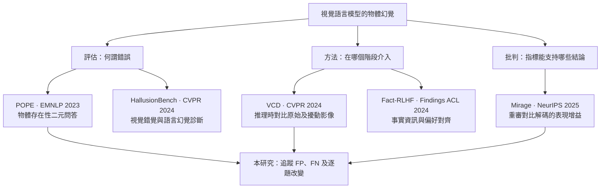

# 文獻知識地圖與比較

研究問題：在固定影像、問題及解碼條件下，回答分數改善是否伴隨「不存在物體」的錯誤下降？

箭頭表示本作業的問題組織方式，不宣稱文獻之間存在因果或引用關係。五篇核心文獻中，VCD、HallusionBench、Mirage 為 2024 年後的 CVPR／NeurIPS 正式會議論文。

## 研究缺口

評估、緩解方法與批判性再評估須合併理解：單看 Accuracy，無法區分少猜了不存在的物體，或多辨認了存在的物體。本研究以固定小型資料保留逐題預測，將增益拆成 FP 與 FN；小型樣本不能據此推廣至整體模型能力。

五篇比較表見 [comparison.md](comparison.md)，完整可核對書目見 [references.bib](references.bib)，一頁綜述見 [報告附件](../reports/AT3-literature-summary.pdf)。
